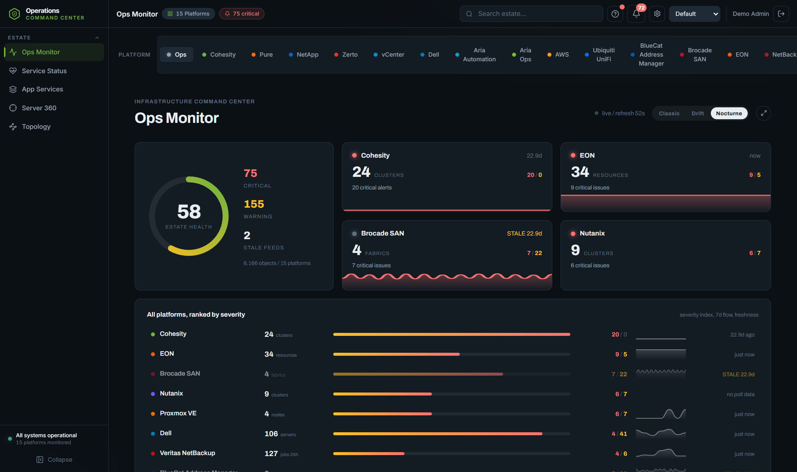
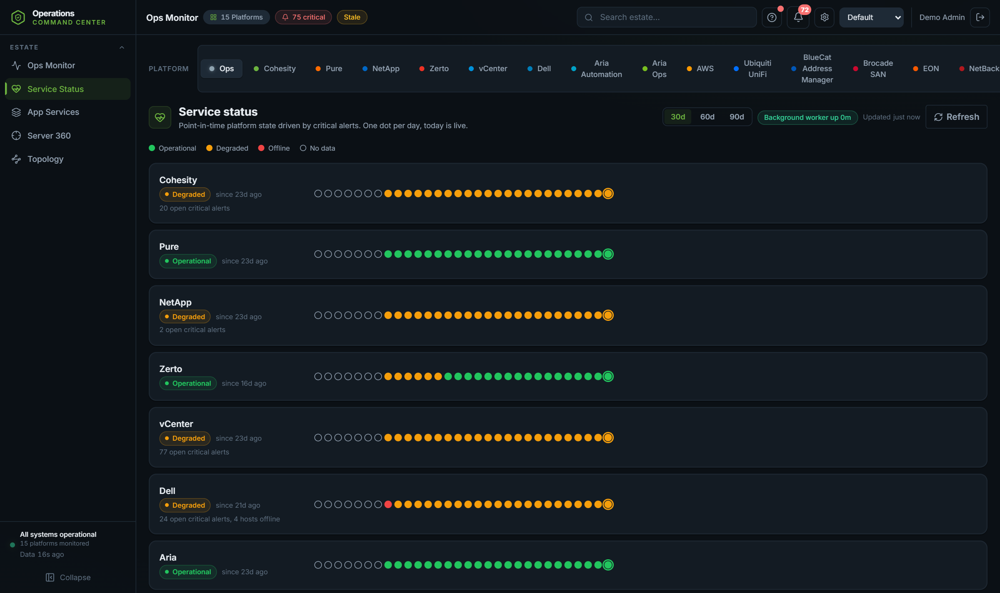
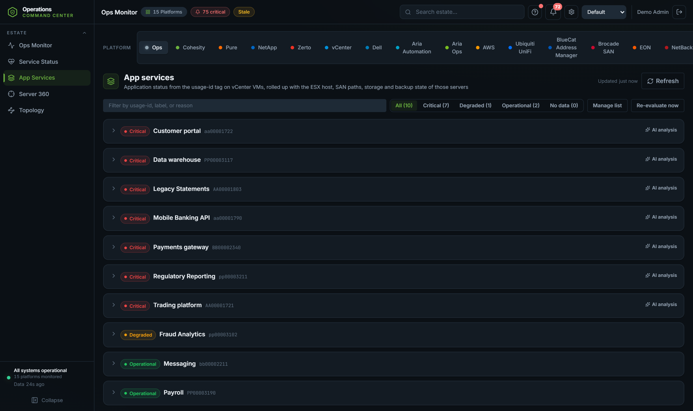
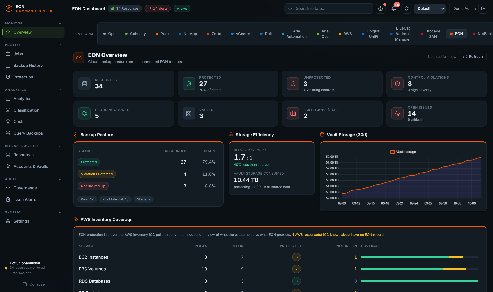
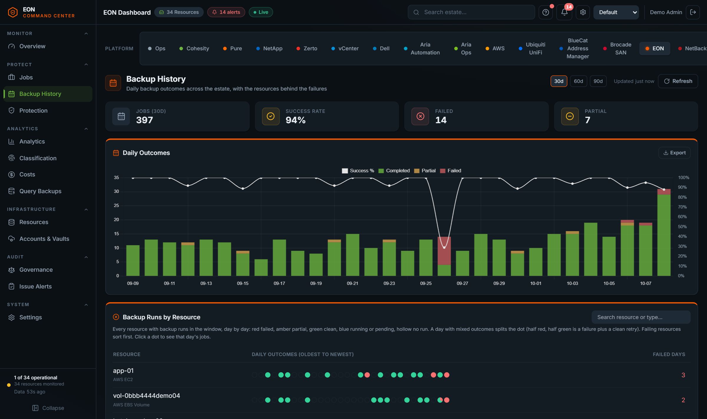
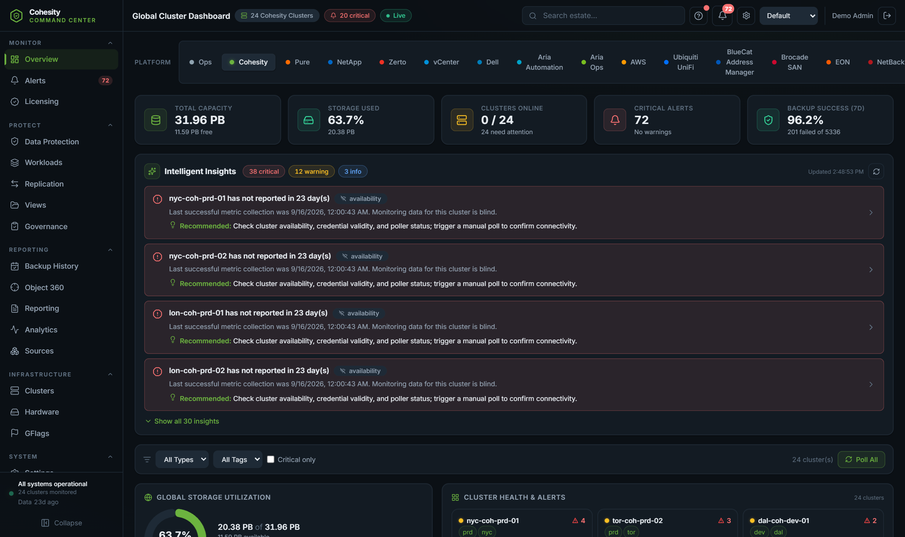

# Infrastructure Command Center (ICC)

ICC is a self-hosted web application that watches an entire infrastructure
estate from one place: backup and recovery, storage, virtualization, cloud,
networking and DNS. It polls each platform's own API on a schedule, stores
what it finds, computes health and risk from that history, and explains
problems in plain language. It runs on Node.js with a React front end and
SQLite storage, so a single VM runs the whole thing.

This repository publishes the installers and release notes. The source code
is not public; every package contains compiled application code and a
private Node runtime.

## Platforms covered

Seventeen platforms ship in every package. At install you pick the ones to
start with (nothing is ticked by default); anything left out can be added
later from the Marketplace, and installed platforms upgrade from the
Marketplace without reinstalling ICC.

| Area | Platforms |
| --- | --- |
| Backup and recovery | Cohesity (Helios multi-cluster and direct), Veritas NetBackup (Alta and primary servers), Zerto (DR replication and journal health), EON (cloud backup posture for AWS, Azure and GCP) |
| Storage | Pure Storage (Pure1 and direct FlashArray), NetApp ONTAP (Active IQ Unified Manager and direct clusters), Dell OpenManage Enterprise (servers, warranty, compliance) |
| Virtualization and cloud | VMware vCenter, Aria Automation, Aria Operations, Nutanix (Prism Central and Element), Proxmox VE, AWS (ten services with cost data) |
| Network and DNS | LogicMonitor (network devices, sites, circuits, reachability), Brocade SANnav (SAN fabrics), Ubiquiti UniFi, BlueCat Address Manager (IPAM and DNS) |

Each platform gets its own section of the app: inventory pages, alert
history, settings with connection testing, and in most cases analytics
pages specific to what that platform knows. Connections are agentless and
read-only; ICC asks the management plane, never the workloads.

## What it looks like

Captured from a demo estate with fictional data.

| | |
| --- | --- |
|  One board answers whether anything is broken right now, with per-system history dots. |  Infrastructure rolled up to the application: servers, hosts, storage, backup and DR as one health row. |
|  Cloud backup posture with storage efficiency, vault growth and an AWS inventory cross-check. |  Day-by-day backup outcomes; mixed days split the dot so a failure with a clean retry reads at a glance. |
|  Per-platform depth: clusters, capacity, alerts and job health for each connected platform. | |

## The insights it produces

Collecting inventory is the easy part. The point of ICC is what it computes
on top:

- Service Status gives a single board answering "is anything broken right
  now" across every platform, with a rule that a platform only goes red
  when every polled source of it is unreachable, and day-by-day history
  dots per system.
- The Ops Agent watches alerts around the clock, groups related ones into
  incidents (same host, same app, or platform-wide bursts), gathers
  evidence, re-polls a source that looks stale before blaming it, and
  writes a triage: what happened, what was reviewed, what a human should
  do next. It detects recurrence, so a fault that clears itself every
  night stops being invisible. Incidents close themselves when the
  evidence says the subject is healthy again, and every autonomous action
  is logged.
- The Estate Advisor writes cross-platform reports: a daily brief,
  a certificate expiry audit across storage, fabric and vCenter, an
  access review of accounts and grants, recovery readiness per
  application, and a change ledger digest.
- Per-platform AI advisors produce focused reports such as backup posture,
  job reliability, capacity runway, DNS hygiene, SAN path redundancy,
  warranty exposure and cloud spend, each from the data ICC already holds.
- App Services rolls infrastructure up to the application: VMs sharing a
  usage tag become one app with server, host, storage, backup, DR and
  network components, each with its own health rule, so "is the customer
  portal protected and replicating" is one row.
- Server 360 answers for a single server name: where it runs, what
  storage paths it has, which switch port it sits on, which DNS records
  point at it, when it was last backed up and by what, and whether DR
  covers it.
- The topology map draws the path from VM through host and fabric to
  array per device, and paints a link red when a SAN path, target port or
  datastore is the thing that broke.
- A configuration change ledger snapshots config (NFS exports, CIFS
  shares, AD group membership, EON scan exclusions, approval rules, IAM)
  on every poll and records dated diffs, so a weakened guardrail is an
  event with a timestamp instead of a surprise.
- Cross-platform checks catch what single consoles miss: Cohesity object
  protection is reconciled per cluster so a stale copy on one cluster is
  not hidden by a fresh one elsewhere, Dell warranty alerts are suppressed
  when a newer contract covers the box, EON posture is laid over the
  AWS inventory ICC polls directly so a resource missing from the backup
  tool stands out, and backup and replication traffic is correlated with
  the switch ports and WAN circuits it crosses.

Alerting is email with per-platform recipients, minimum severities and
per-alert-type switches that default off, so the mail that goes out is the
mail someone chose to receive. The Ops Agent can also post incidents to a
Microsoft Teams channel.

## AI, with privacy handled

Every AI feature is optional; the platform computes its health rules in
code and works fully without a model. When a provider is configured (an
OpenAI key, GitHub Models, or any OpenAI-compatible endpoint including a
local bridge), ICC adds the narrative layer: advisor reports, incident
triage, and on-request analysis of a failing system.

Before any request leaves the instance, an anonymization layer replaces
hostnames, cluster names, IPs, ARNs and account identifiers with stable
tokens, and restores them locally in the response. A Privacy Inspector
page shows exactly what was sent and received for every call.

## Architecture

- One web service plus a separate poller process per tenant; both share
  the SQLite database in WAL mode, and a heartbeat watchdog reports a
  silent poller instead of letting it fail quietly.
- Multi-tenant by design: a database file per tenant, tenant in the URL,
  per-tenant credentials, encryption keys, licensing and retention, with
  sealed archive export when a tenant closes. Single-tenant installs just
  use one tenant.
- Platforms are plugins against a documented registry contract
  (migrations, router, poller, ops summary, alert collector, search,
  Server 360, topology). Packs are signed zip archives verified against a
  pinned public key before install, and install from a URL or file
  without a rebuild.
- Credentials are encrypted with AES-256-GCM at rest, and a saved secret
  is only ever sent to the address it was saved for; changing a host
  requires re-entering the secret. Sessions use argon2 password hashing,
  lockout, CSRF tokens and rate limiting.
- RBAC covers per-platform view and manage grants, AD/LDAPS sign-in with
  group sync, and local break-glass accounts.

## Known limits

- Collection is poll-based (minutes, not seconds); ICC is an operations
  and risk console, not a real-time metrics pipeline.
- SQLite is the store; the design target is the estate scale of a large
  enterprise team (hundreds of systems, millions of history rows), not a
  SaaS back end.
- ICC is read-only toward the platforms it watches, by policy; the few
  exceptions (a gateway override, re-running a poll) are stored locally or
  are harmless re-reads.
- The Windows installer is not code-signed yet, so SmartScreen warns on
  first run.

## Download and install

Pick the package for your platform from the Releases page. Every release
lists the size and SHA256 of each file; check the hash after downloading
(Get-FileHash on Windows, sha256sum on Linux).

| Package | Platform | How |
| --- | --- | --- |
| icc-setup-(version)-x64.exe | Windows Server 2019 or later, Windows 10/11 (x64) | Run from an account with administrator rights. Installs to C:\Program Files\ICC as two services (ICC-Dashboard, ICC-Poller). |
| icc-(version)-1.x86_64.rpm | RHEL, Rocky, Alma 8 or later (x86_64) | sudo dnf install ./icc-(version)-1.x86_64.rpm. Installs under /opt/icc with systemd units icc-dashboard and icc-poller. |
| icc-(version)-linux-x64.tar.gz | Ubuntu 22.04 or later (x64) | Extract, then sudo bash deploy/install.sh. Same layout and units as the RPM. |

Requirements: 2 CPU, 4 GB RAM and 10 GB disk for a small estate; more
disk as history grows. Network access from ICC to each platform's
management API, and from browsers to ICC on port 3001 (changeable).

## First run

1. Licence: the installer asks for a licence key. Leave it empty to start
   a 30-day trial; a key can be entered later under Global Settings.
2. Platforms: tick the platforms this install starts with. At least one is
   required. The rest can be added later from the Marketplace.
3. Account: the first account is User Admin / Password Admin. The
   dashboard asks for a new password at the first sign-in.
4. Open the dashboard. Windows opens http://localhost:3001/ when the
   wizard finishes; Linux prints the address at the end of the install.
5. Add connections from each platform's Settings page (connection test
   included), then watch the first poll land on the Ops Monitor.

Unattended installs:

    icc-setup-1.0.0-x64.exe /VERYSILENT /LICENSEKEY=... /PORT=3001 /PLATFORMS=cohesity,vcenter
    sudo ICC_PLATFORMS=cohesity,vcenter dnf install ./icc-1.0.0-1.x86_64.rpm
    sudo bash deploy/install.sh --license-key ... --port 3001 --platforms cohesity,vcenter

Without a platform list the dashboard asks at the first sign-in.

## Upgrades

Run the newer package over the existing install (the Windows wizard, dnf
upgrade, or install.sh again). Data, installed packs, logs and the .env
file are kept; the services are stopped, a snapshot of the database is
taken, and the services restart on the new code.

## Licence

Copyright Douglas Austin. See LICENSE for terms: evaluation is time-boxed
to the trial, production use needs a licence key.
